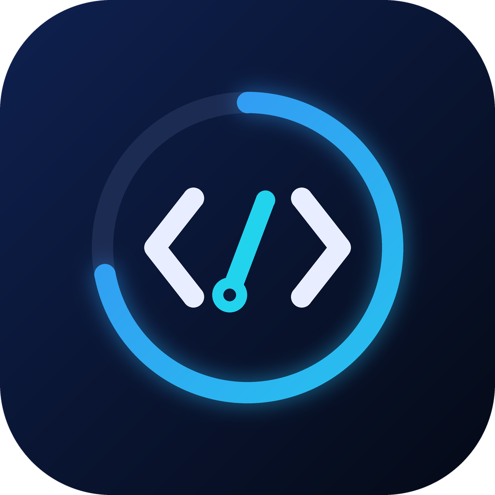
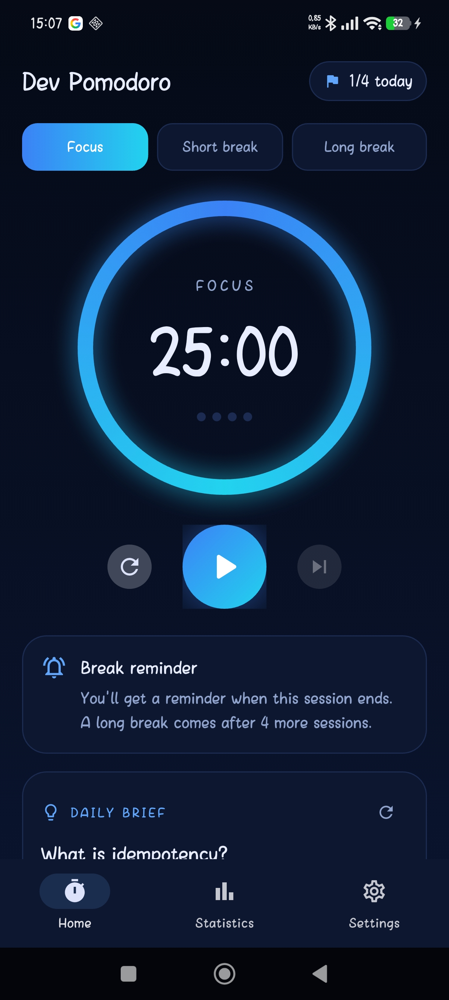
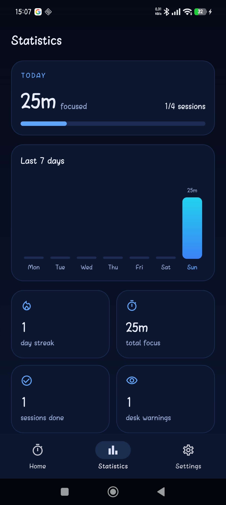
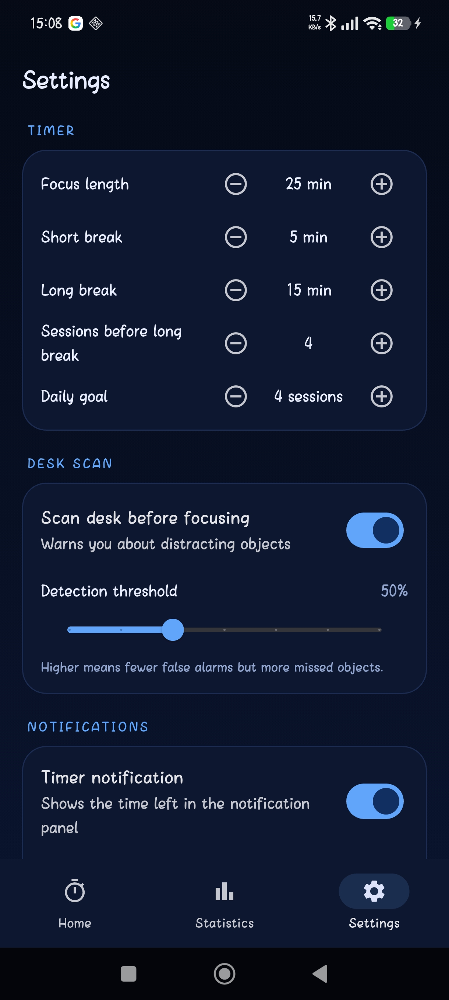

<p align="center">
  
</p>

<h1 align="center">Dev Pomodoro</h1>

<p align="center">
  A Pomodoro timer for software developers. Scan your desk before you start,
  and the app warns you about objects that could break your focus.
</p>

## Features

- Pomodoro timer with focus, short break and long break sessions
- Desk scan: on-device object detection (TensorFlow Lite, SSD MobileNet on COCO) warns about distractions such as phones or snacks
- Live countdown in the notification panel and an alert when a session ends
- Daily brief with short developer tips ("What is `git push`?")
- Daily statistics: focus time, sessions, streak and weekly chart
- Dark (black-blue) and light (white-blue) themes
- English and Turkish

## Tech stack

Flutter, Dart, TensorFlow Lite, Python / TensorFlow (model experiments)

## Getting started

1. Install Flutter and Android Studio.
2. Clone the repository:
```bash
   git clone https://github.com/YOUR-USERNAME/dev-pomodoro.git
   cd dev-pomodoro
   flutter pub get
```
3. Download the COCO SSD MobileNet TFLite model and put `detect.tflite` and
   `labelmap.txt` into the `assets/` folder.
4. Connect an Android phone and run `flutter run`.

## Screenshots

| Home | Statistics | Settings |
|------|------------|----------|
|  |  |  |

## Roadmap

- Custom-trained CNN for developer-specific distractions
- More languages
- iOS support

## License

MIT
